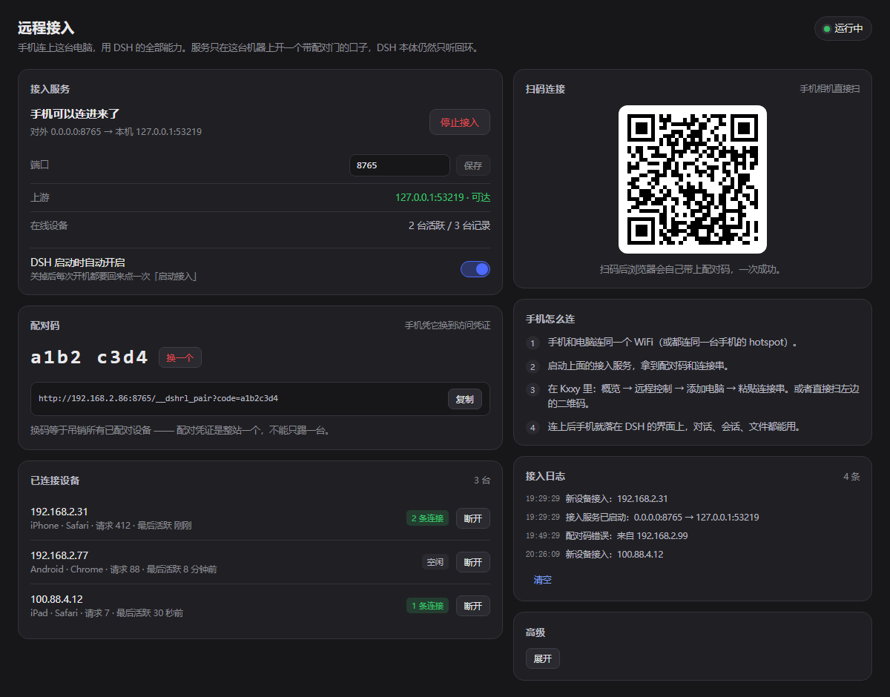
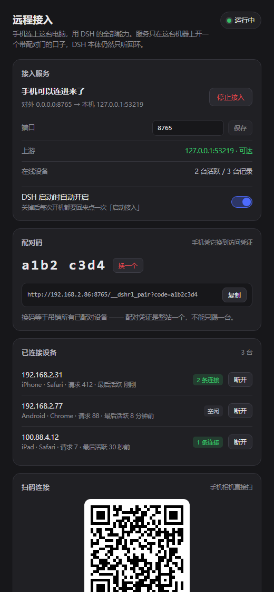

# dsh-remote-link

DSH 桌面端插件：把「手机连上这台电脑」做成一块可视化面板 —— 一键开关接入服务、
配对码与二维码、谁连着、断开、换码。



装上之后，DSH 左侧导航会多出一行「**远程接入**」。点进去就是上面这块面板，
不用再开命令行窗口跑连接器。

---

## 它解决什么问题

DSH 的 webServer 只监听 `127.0.0.1`，而且它的 `host` 配置**明确拒绝通配地址**
（源码注释原话：绑定所有网卡等于把远程代码执行暴露到网络上）。这是有意的安全
边界，不该绕过。

所以手机在局域网里直接指过去一定连不上。这个插件在**本机回环之外再开一个
带配对门的口子**：

- 对外监听 `0.0.0.0:8765`（可改），把请求转发到 `127.0.0.1:<DSH 端口>`；
- 转发时把 `Host` 改回上游 authority，于是上游认为请求来自本机，它那套
  origin / cookie 校验原样通过 —— 一行都不用改 DSH；
- 没配对码的请求到不了上游（局域网里扫得到端口，但打不开会话）；
- WebSocket upgrade 一起透传（漏了这条就是「界面能开、一发消息就断」）。



## 安装

前提：DSH 桌面端**至少启动过一次**（要先有 profile 目录），电脑上有 Node.js 18+。

```bash
git clone https://github.com/438417623wq/dshKXHL.git
cd dshKXHL
node scripts/install.mjs
```

Windows 也可以双击 `scripts\install.cmd`（它内部就是上面那条命令，末尾带 pause）。

安装器只做三件事，全部可逆：

1. 在 `~/.dsh/profiles/desktop/node_modules/` 下建一个指向本目录的链接
   （Windows 用 directory junction，不需要管理员权限）；
2. 在 profile 的 `package.json` 里登记 `dependencies["dsh-remote-link"]`；
3. 把它加进 `dsh.profile.bundles` —— **真正决定加不加载的是这一项**。

改动前会把清单备份成 `package.json.bak-<时间戳>`。

先看看它要改什么：

```bash
node scripts/install.mjs --dry-run
```

装完**完全退出 DSH 再打开**（关窗口不算）。

## 用起来

| 位置 | 作用 |
|---|---|
| 「启动接入」 | 开始监听。启动后才有配对码与连接串 |
| 配对码 | 手机凭它换访问凭证。`换一个` = 吊销所有已配对设备 |
| 连接串 / 二维码 | 手机端的入口。扫码或整条粘贴都行 |
| 已连接设备 | IP、机型浏览器、请求数、最后活跃。`断开`只断当前连接 |
| 端口 | 对外端口，默认 8765（避开 8080 常见占用与 DSH 自己的端口） |
| DSH 启动时自动开启 | 关掉则每次开机要手点一次；默认关 |
| 接入日志 | 最近 60 条：谁进来了、谁配对码错了、上游是否可达 |

### 手机侧

1. 手机和电脑连同一个 WiFi（电脑走热点、手机连热点也算同一个局域网）。
2. 电脑上启动接入服务，拿到二维码或连接串。
3. 手机相机扫码 —— 或者打开 Kxxy：概览 → 远程控制 → 添加电脑 → 粘贴连接串。
4. 连上后手机就落在 DSH 界面上，对话、会话、文件都能用。

### 不在同一个网络怎么办

插件的口子只负责「本机 8765 对局域网开放」。异地接入请用你已有的隧道
（Tailscale / Cloudflare Tunnel / frp）把**本机 8765** 暴露出去，**不是** DSH
自己的端口。把连接串里的 IP 换成隧道域名即可，配对码不变。

## 排错

| 现象 | 原因 | 处理 |
|---|---|---|
| 导航里没有「远程接入」 | 没重启，或包没被加载 | 完全退出 DSH 再开；看启动日志有没有 `dsh-remote-link` 的报错 |
| 点启动提示端口被占用 | 8765 被别的程序占了 | 面板里换一个端口再启动 |
| 手机打开报「连不上本机的 DSH」 | DSH 没在跑，或上游不可达 | 面板「上游」那一行会显示 ✗；确认桌面端还开着 |
| 手机打开报「需要配对码」 | 连接串只复制了 IP，丢了 `?code=` | 复制整条连接串（面板上有「复制」按钮） |
| 昨天能连，今天不行 | 换过配对码，或 DSH 重启后端口变了 | 重新扫码 |
| 能进界面但对话不更新 | WebSocket 被中间设备拦了 | 换端口试；企业网络的代理常拦 upgrade |
| 打开是全屏一句 `dsh web authentication required; reopen the URL printed by dsh web.` | 上游没拿到会话 cookie（v0.1.x 的已知缺陷） | 升级到 **v0.2.0+**：插件会自动取本进程 launch token 并换会话；在面板「高级」里能看到「鉴权方式 / 上游会话」两行 |
| 面板「鉴权方式」显示「未取到」 | 这个 DSH 版本的 ConnectionService 没暴露 `authenticatedUrl` | 在「高级」里手工填一次 token，或回退到命令行连接器 |
| 断开后几秒又连上 | 配对凭证是整站一个，断开只是断 socket | 想彻底断开请「换一个」配对码 |

自查（不依赖 DSH，68 项断言，会真起一个假上游走一遍配对门与转发）：

```bash
node scripts/selftest.mjs
```

## 卸载

```bash
node scripts/install.mjs --uninstall
```

会撤掉链接与两处登记，profile 回到装之前的样子（再重启 DSH）。

## 开发

产物 `lib/client.js` **已经提交进仓库**，所以使用者不需要 node_modules。
改代码的人：

```bash
npm install                 # 只有 esbuild 与 qrcode-generator
npm run build:client        # src/client/* → lib/client.js
npm run selftest            # host 反代 + client 槽位注册
node .preview/serve.mjs     # 本地预览面板（不打桩 DSH 也能看）
```

### 结构

```
lib/index.js      host 半边：RPC 端点 /api/remote-link + 状态与动作分派
lib/connector.js  接入服务本体：反代、配对门、WebSocket、设备台账
lib/client.js     client 半边（构建产物）：侧栏行 + 主面板
src/client/       上面那半边的源码（手写 createElement，不用 JSX）
scripts/          安装器、构建、自测、预览
```

### 两个容易踩的坑（写给改这个插件的人）

1. **client bundle 的注册 id 必须等于 `package.json` 的 `name`。**
   宿主按加载行的包名建 client entry id，只认 `window.__ModuleLoader__.load({ id })`
   这一处注册。不一致时页面永远等不到 bundle，**而且没有任何报错**。
   `scripts/build-client.mjs` 会从产物里回读这个 id 并断言。

2. **`main` 槽的 `key` 必须等于 `sidebar.panellist` 的 `id`。**
   点侧栏那一行时宿主会 `layout.selectPanel(id)`，去 `main` 槽里按 key 找渲染体；
   对不上就是「未注册的 panel」。

## 已知边界

- 配对凭证是**整站一个** cookie，没有逐设备吊销的能力。「断开」只断当前 socket，
  浏览器几秒后会自己重连；真正的吊销手段是「换一个」配对码。
- 设备是按 `IP + User-Agent` 归并的，同一个 NAT 后面同型号手机可能被算成一台。
- 「断开」按远端 IP 批量断 socket，同一 NAT 后的多台设备会一起断。
- **鉴权靠 DSH 自己的 launch token**，插件调 `ctx.connection.authenticatedUrl()`
  自动取，然后用它向本机换一个签名 cookie 存在连接器内存里；手机侧拿不到 token，
  也拿不到上游 cookie。前提是那个 DSH 版本仍公开这个方法 —— 没有的话面板会显示
  「鉴权方式：未取到」，此时可在「高级」里手工填 token 兜底。
- 只支持 `http://` 上游 —— TLS 交给隧道负责，插件不碰证书。

## License

MIT
